# Penny architecture

Penny is a same-origin React and FastAPI application with a WhatsApp bridge alongside it. A
family adds a phone number to their group chat; from that moment Penny reads the conversation,
asks who is being cared for, turns what the family says into a structured care record, and
answers when she is addressed by name.

Everything below describes the current working tree. Where something is specified but not
built, it says so.

## The one-paragraph version

Every inbound message arrives at one webhook, is normalised to one contract, and is inserted by
one function that resolves which household it belongs to. After the webhook has answered, three
kinds of background work may run against that message: a voice note is transcribed and a photo
is stored and described, the onboarding interview may read it, and extraction turns a batch of
messages into care events. A scheduled tick catches the households that have gone quiet. Everything Penny says goes back out
through one hardened door.

## System

```mermaid
flowchart TB
    family["Family member<br/>web browser"]
    whatsapp["WhatsApp group"]
    openai["OpenAI<br/>Responses + audio.transcriptions"]

    subgraph railway["Railway project"]
        direction LR

        subgraph penny["penny service — one Docker image"]
            direction TB

            subgraph browser["React 19 SPA (Vite, Tailwind 4, shadcn)"]
                direction LR
                screens["Timeline · Settings · Import<br/>Login · Report"]
                query["TanStack Query<br/>cache, polling, optimistic edits"]
                client["Typed API client<br/>same-origin /api"]
                screens --> query --> client
            end

            subgraph fastapi["FastAPI application"]
                direction TB
                middleware["JSON logging · error handlers<br/>dev-only CORS"]
                session["Session and tenant boundary<br/>signed HttpOnly cookie carrying<br/>household_id + session_version"]
                readapi["Feed · upcoming · events<br/>household + vitals · members<br/>media · reports · auth"]
                importapi["Import — preview, start, poll"]
                waapi["WhatsApp — status, link, relink"]
                webhook["Webhook — raw-body HMAC<br/>join gates · ingest · dispatch"]
                tickapi["POST /api/internal/tick<br/>shared secret, no cookie"]
                spa["SPA catch-all — frontend/dist"]
                middleware --> session --> readapi
                middleware --> webhook
                middleware --> tickapi
                readapi --> spa
            end

            subgraph ingest["Shared ingestion — the one door in"]
                direction LR
                txt["WhatsApp .txt export parser<br/>user confirms dayfirst + timezone"]
                contract["InboundMessage contract"]
                seam["ingest_messages<br/>resolve household + member<br/>hash and insert idempotently"]
                txt --> contract --> seam
            end

            subgraph work["Background work — after the 200"]
                direction TB
                transcribe["Transcription<br/>download media, transcribe,<br/>mark the payload"]
                derive["Media derivation<br/>store the bytes, describe them,<br/>mark the excerpt derived"]
                reports["Report generation<br/>one call over a year,<br/>every claim cited"]
                interview["Onboarding interview<br/>record answers, answer mentions,<br/>say it back — one call"]
                assistant["@-mention reply<br/>answer from the record only<br/>(and interview fallback)"]
                extraction["Extraction service<br/>advisory lock · cadence gate<br/>budget guard · bounded batch"]
                runner["Chunk + overlap · concurrent<br/>structured calls · validate<br/>merge · deduplicate"]
                persist["Persist<br/>protect human edits<br/>stamp extracted_at"]
                extraction --> runner --> persist
            end

            profile["care_profile<br/>THE relevance specification<br/>one renderer · one hash"]
            outbound["outbound.send_to_group<br/>the one door out<br/>URL allowlist unless trusted"]
            gateway["LLM gateway<br/>retry · truncation · usage<br/>cost accounting · budget"]
        end

        subgraph gowa["gowa service"]
            direction TB
            bridge["WhatsApp bridge (whatsmeow)"]
            pairing["Status + pairing QR<br/>Basic Auth, private network"]
            media["Media download<br/>by provider_message_id"]
            chatstore[("Persistent volume<br/>chat storage")]
            bridge --- pairing
            bridge --- media
            bridge --- chatstore
        end

        tick["tick service<br/>cron → POST /api/internal/tick"]

        postgres[("PostgreSQL 16<br/>households · members · whatsapp_links<br/>known_groups · messages · llm_runs<br/>events · imports · reports<br/><br/>household_id is the tenant key<br/>unique indexes enforce replay safety")]
        volume[("Media volume<br/>one directory per household<br/>the unit of deletion")]
    end

    family -->|HTTPS| screens
    client -->|JSON + multipart<br/>cookie credentials| middleware
    spa -->|index.html + assets| family

    whatsapp -->|linked-device events| bridge
    bridge -->|signed webhook, private network| webhook
    waapi -->|status, link, relink| pairing
    transcribe -->|fetch bytes| media

    webhook --> contract
    importapi --> txt
    seam -->|messages + members| postgres

    webhook -.->|after the response| transcribe
    webhook -.->|after the response| derive
    webhook -.->|after the response| interview
    webhook -.->|after the response| assistant
    webhook -.->|after the response| extraction
    tick -->|hourly, shared secret| tickapi
    tickapi --> extraction

    profile --> extraction
    profile --> interview
    profile --> assistant
    interview -->|write_profile| profile
    interview --> outbound
    assistant --> outbound
    webhook -->|welcome, trusted| outbound
    outbound -->|send| bridge

    extraction --> gateway
    interview --> gateway
    assistant --> gateway
    transcribe --> gateway
    derive --> gateway
    reports --> gateway
    derive -->|fetch bytes| media
    derive -->|write, per household| volume
    readapi -->|serve bytes, 404 on a stranger| volume
    readapi --> reports
    gateway -->|strict JSON schema| openai
    openai -->|structured output + usage| gateway
    gateway -->|audit every attempt| postgres
    persist --> postgres
    readapi --> postgres
    profile --> postgres

    classDef active fill:#e9f7ef,stroke:#247a46,color:#12351f,stroke-width:2px;
    classDef external fill:#eef3f8,stroke:#536779,color:#1e2933;
    classDef store fill:#f2ecf8,stroke:#704b8f,color:#2f1f3a,stroke-width:2px;
    classDef keystone fill:#fdf0f5,stroke:#a03060,color:#3d1123,stroke-width:2px;

    class middleware,session,readapi,importapi,waapi,webhook,tickapi,spa active;
    class family,whatsapp,openai external;
    class postgres,chatstore,volume store;
    class profile,outbound,seam keystone;
```



The three pink nodes are the chokepoints. Each exists because the same mistake was made twice
before it was one function: `ingest_messages` is the only writer of `messages`,
`outbound.send_to_group` is the only sender to a group, and `care_profile` is the only renderer
of the brief.

## What happens to one inbound message

```
GOWA delivers  POST /api/whatsapp/webhook
      │
      ├─ raw bytes → HMAC verify → THEN parse      never parse before authenticating
      ├─ is_from_me?                               drop; GOWA cannot filter our own sends
      ├─ group.joined / group.participants?        → the join gates (below)
      │
      ├─ chat_id ends @g.us?                       direct chats are ignored, not ingested
      ├─ ingest_messages(chat_id, [InboundMessage])
      │     resolve group → household              a miss raises; NEVER auto-provisions
      │     resolve senders → members              before hashing, so the hash keys on a member
      │     content_hash over minute bucket        a webhook and an export line collapse to one row
      │     INSERT ... ON CONFLICT DO NOTHING
      │
      └─ 200, then background work on `inserted` only  ← a GOWA retry costs nothing
            │
            ├─ audio?            transcribe, then extract (one task, ordered)
            ├─ @-mention?        interview open → the interview answers AND records
            │                    (assistant fallback) · closed → the assistant answers
            └─ else?             interview open + long enough → the interview listens
```

The webhook answers within GOWA's 10-second budget and never raises: GOWA retries five times on
any non-2xx, and a retry becomes a duplicate message in a family's chat. Every outcome a retry
cannot fix — an unlinked group, a direct chat, an unparseable body — is a 200 with a reason. A
bad signature is the one loud failure.

## Who may speak, and when

Penny is paired to a real WhatsApp account that belongs to real group chats. She once answered
in all of them. Everything here is downstream of that.

| Trigger | Who answers | Gate |
|---|---|---|
| `group.joined` | the welcome (credentials, then one question) | startup quiet period **and** the `known_groups` ledger |
| `@Penny …`, interview open | the interview, in the same call that records — assistant fallback | linked group, explicit mention, mention budget |
| `@Penny …`, interview closed | the assistant | linked group, explicit mention, mention budget |
| any other message, interview open | the interview | linked group, length floor, 14-day window, interview budget |
| anything else | nobody | — |

**A mention is always answered, and one owner speaks per message.** The mention verdict is
decided first. During the open interview it routes to the interview call itself — one Penny,
answering the question and recording the answer in one reply, with the assistant as fallback
so a mention is never swallowed — because two owners would earn a family who @-mentions her
while answering her question two replies. The two reply budgets are independent (mentions
generous, unprompted interview turns tight), so onboarding can never starve a mention of its
answer.

**Join gates.** `whatsmeow` re-emits `JoinedGroup` during app-state sync for groups the account
was already in, and GOWA has no guard for it. So a join inside the startup quiet period is
recorded and never provisions, and any earlier sighting of a group id in `known_groups` makes it
old news forever. `group.participants` can only feed the ledger; it can never provision.

## The relevance specification

`care_profile` is the newest keystone and the least obvious. A care record is built from a group
chat, and a group chat is mostly noise — so something has to decide what counts.

```
onboarding welcome asks 3 questions
        │
family answers as an ordinary message
        │
interview reads: profile so far + last 30 messages, sender-attributed
        │
write_profile()  ─ hash unchanged ─→  store, cost nothing
        │
        └─ hash changed ─→ store, clear extracted_at for the household
                                    │
                                    └→ the corrected filter re-reads the history
```

The hash covers the profile's rendered lines and nothing else. Participants and the timezone are
in the brief because the model needs them, and outside the hash because a member joining or a
timezone typo must not re-read six months of chat against a $15/month budget. A field that is
never rendered — `interview_closed` — cannot change what was extracted, so it cannot change the
hash either.

`llm_runs.care_brief_hash` stores the same value, so "which filter produced this event?" is a
join rather than an investigation.

## Extraction

`messages.extracted_at IS NULL` is the whole incremental mechanism. A budget abort, a redeploy
mid-run, or a cleared cursor all self-heal for the same reason: the next run reads the NULLs.

Four gates sit between a message arriving and money being spent:

1. **Advisory lock**, per household, `try` not blocking — a second run has nothing to add.
2. **Cadence gate** — wait for `extract_min_unextracted` messages or an oldest message older
   than `extract_max_age_hours`. Extraction is billed per call and ~1,400 tokens of prompt ride
   along with every one; production once measured 13 runs for 14 messages, 18× the plan.
3. **Bounded batch** — `_unextracted` reads at most `extract_max_batch_messages`, because "all
   unextracted" is six months of chat the first time a care profile changes.
4. **Budget guard** — a rolling 30-day window over `llm_runs.cost_usd`, aborting mid-flight.

A voice note is withheld from extraction until its transcript lands or the grace window expires.
Extracting `[voice note]` first would stamp the row, and the transcript would arrive seconds
later against a message nobody will ever read again.

## Deployment

Three Railway services and one Postgres, all provisioned from `infra/provision.py`:

| Service | What it is |
|---|---|
| `penny` | the Docker image: SPA built in the first stage, copied into the Python image, served same-origin with the API |
| `gowa` | the WhatsApp bridge, persistent volume, private network only |
| `tick` | cron, POSTs `/api/internal/tick` with the shared secret |

Alembic runs in Railway's pre-deploy phase. Secrets that must agree across services —
`INTERNAL_TICK_SECRET`, `WHATSAPP_WEBHOOK_SECRET`, the GOWA basic auth pair — are generated once
and written to both sides, with a drift warning when they disagree.

> **Unverified:** the cron schedule field. There was no `railway` CLI available when `tick` was
> built, so rather than guess a flag the schedule is a `sleep` loop in the container's start
> command. It fails visibly rather than silently, and `report_manual_steps` prints the command to
> paste. Confirm before relying on it.

## Media

An image or a document arrives with no text at all, so two independent things happen to it and
neither waits on the other.

The **bytes** are downloaded from GOWA and written to a per-household directory on a Railway
volume. `household_id` is typed `UUID` everywhere in `media.py` — that is the security control
rather than a nicety, because `str(UUID)` can only produce `[0-9a-f-]` and no spelling of the
argument escapes the root. `GET /api/media/{message_id}` serves them back through the same
`CurrentHousehold` dependency every other read uses, and answers a stranger's message id with a
404 **byte-identical** to the one a random UUID gets: a different body, length or header would
make the route an existence oracle. Deleting a household takes its directory with it.

The **words** are a model's description, and they carry `derived_from_media: true` on the excerpt
so the record never attributes to Sarah a sentence Sarah did not write. The two halves are
independent in both directions: a deployment with no volume configured keeps no files and still
reads the description into the timeline, which is the state every deploy without a volume is in.

Extraction withholds a media message until its description lands or the grace window expires, the
same rule and the same reason as a voice note.

## Reports

`POST /api/reports` runs one call over a year of the record and returns a document whose every
claim carries citations back to the entries behind it; the server drops any citation that did not
resolve and strips its marker out of the prose, so nothing rendered points at nothing.

Generating is a **mutation and never a query**. A query fires on mount, on remount, on window
focus and on a poll, and the one-a-day limit would turn each of those into a 429 the family did
not cause. The panel is closed until somebody asks, because a summary is a reading of the record
rather than part of it, and leaving one open above the timeline puts a stale interpretation
between the family and the thing it interpreted.

## Specified but not built

- **`claude-agent-sdk`.** Deferred deliberately. The extraction and assistant paths use the
  OpenAI Responses API with strict structured outputs; a session-based agent is a different
  shape and was not worth carrying while the record itself was still being built.
- **The `imports.py` module.** Superseded by the shared `ingest_messages` seam and pending
  deletion.

## Architectural invariants

- Every tenant-owned row carries `household_id`. One dependency applies that boundary; there is
  no RLS behind it to catch a query that forgets. `known_groups` is the single deliberate
  exception and says why in its own docstring.
- Cross-tenant reads return **404, never 403**. A 403 is an existence oracle.
- Live webhooks and file imports normalise to the same `InboundMessage` and call the same
  ingestion function.
- Replay safety lives in PostgreSQL unique indexes, not in request handlers.
- `messages.extracted_at IS NULL` is the resumable extraction cursor.
- Human-edited event fields and soft-deleted tombstones survive later extraction runs.
- Every LLM attempt is recorded with model, prompt version, care-brief hash, usage, latency,
  cost and outcome — failures included.
- Nothing in the webhook path raises, and silence is the safe failure everywhere Penny speaks.
- Message text, transcripts, prompts, replies and credentials never reach a log line. Ids and
  counts only.
